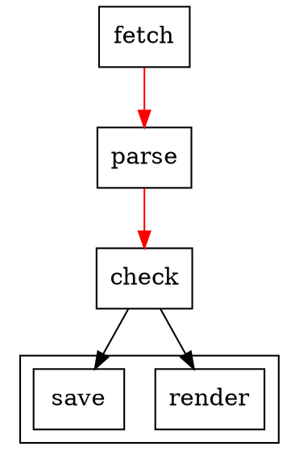

# dot-parser

A parser for the [DOT graph language](https://graphviz.org/doc/info/lang.html),
the text format used by Graphviz, written in Zig.

It reads DOT text and gives you its structure: nodes, edges, attributes and
subgraphs. It also gives clear error messages. It does not draw graphs or
compute layouts. You decide what to build on top, for example a linter, a
formatter, or a converter into your own graph type.

The package has three independent modules:

- **`dot_parser`** parses DOT.
- **`markup_parser`** parses HTML-like markup, such as Graphviz's
  `label=<<b>Hi</b>>` labels. It can check labels while DOT is parsed, or work
  on its own with no DOT at all. By default it checks labels against
  Graphviz's rules: tag and attribute names since 0.5.0, and also label
  content, attribute values and references (unreleased). Select
  [structural mode](docs/MARKUP.md) for other markup.
- **`string_processor`** (unreleased) checks string values: exact matches,
  allowed values, or your own rules. It works on its own, or on chosen DOT and
  markup attributes. See [standalone string checks](docs/STRINGS.md).

On top of the parser, the optional [`dot.ir` graph layer](docs/IR.md)
(unreleased) works out what a file means: one node per name, which subgraphs
each node is in, and each node's and edge's attributes after defaults. Edge
sets like `a -> { b c }` stay compact until you ask for individual edges. It
can also work on unfinished files, in small steps, or in fixed memory.
Ordinary parsing doesn't run it or allocate anything for it.

> **Status: experimental (0.x).** It works and is well tested, but names may
> still change between versions. Breaking changes are listed in the
> [changelog](CHANGELOG.md).



## Highlights

- **Helpful errors.** Each problem points at the exact spot, explains what is
  wrong, and often suggests a fix. Parsing keeps going after an error, so you
  see more than one problem at a time.
- **You choose where memory comes from.** Use any allocator, an arena, or
  fixed buffers with no heap allocation at all.
- **Runs anywhere.** No dependencies, no OS calls, no file access. It builds
  for embedded targets and WebAssembly.
- **Keeps what was written.** Spelling, order and duplicates are kept exactly.
  Nothing is silently rewritten or interpreted.
- **Supports safe handling of untrusted input.** Parsing uses no recursion and
  makes one pass over the input. Limits are off by default, so you set
  explicit budgets for size, nesting and memory, and can parse step by step
  with cancellation.
- **Configurable.** Strict by default, with a lenient mode and optional
  extra checks.
- **HTML-like markup, inside DOT or on its own.** Check the inside of labels
  such as `label=<<b>Hi</b>>` while parsing DOT, or parse HTML-like markup by
  itself.
- **Bring your own processor.** Swap in your own label checker at compile time.
  Its settings plug into the same settings system as DOT's.
- **A graph when you want one** (unreleased). The optional
  [graph layer](docs/IR.md) gives unique nodes, effective attributes and
  individual edges, with limits on how much work and memory it may use.

## A quick look

```zig
const std = @import("std");
const dot = @import("dot_parser");

pub fn main(init: std.process.Init) !void {
    const allocator = init.gpa;
    var buffer: [4096]u8 = undefined;
    var stdout_writer: std.Io.File.Writer = .init(.stdout(), init.io, &buffer);
    const stdout = &stdout_writer.interface;
    defer stdout.flush() catch {};

    const source =
        \\digraph {
        \\    a -> b;
        \\    b -> c [color=red];
        \\}
    ;

    // Problems are collected here instead of being printed or thrown.
    var bag = dot.GrowableDiagnosticBag.init(allocator, .{});
    defer bag.deinit();

    // Parse the text, then check it (for example, `--` inside a digraph).
    var result = dot.parseAndValidate(allocator, source, bag.sink(), .{});
    defer result.deinit(allocator);

    if (!result.documentValid()) {
        for (bag.items(), 1..) |problem, number| {
            try dot.console.renderBoxed(problem, number, .{ .source = source, .source_name = "graph.dot" }, stdout);
        }
        return;
    }

    const document = result.document.?;
    var edges = document.edgeIterator();
    while (edges.next()) |edge| {
        // An edge end is a node or a whole subgraph (`a -> { b c }`).
        if (edge.left != .node or edge.right != .node) continue;
        const from = document.nodeReference(edge.left.node).?.identifier;
        const to = document.nodeReference(edge.right.node).?.identifier;
        try stdout.print("{s} {s} {s}\n", .{
            document.text(from), edge.operator.lexeme(), document.text(to),
        });
    }
}
```

This prints:

```text
a -> b
b -> c
```

If line 3 said `b -- c` instead (an undirected edge in a directed graph), you
would get:

```text
┌─ Error 1: edge operator does not match the graph kind
│ graph.dot:3:7
│
│ 1 │ digraph {
│   │ ─────── the document is directed because of this keyword
│ ⋯
│ 3 │     b -- c [color=red];
│   │       ^^ expected '->', found '--'
│
│ Hint: change '--' to '->', or declare the document with 'graph'
│ Fix: replace '--' with '->' (one possible repair)
└─ E1 ─ [dot_parser:E.Validation.Operator.002]
```

This program is [examples/quick_start.zig](examples/quick_start.zig).
[Getting started](docs/GETTING_STARTED.md) walks through it step by step.

## Install

The development version requires Zig **0.17.0**. Add it to your project:

```sh
zig fetch --save git+https://github.com/AshutoshMahala/dot-parser#main
```

Then import the modules you need in your `build.zig`:

```zig
const dot_parser = b.dependency("dot_parser", .{ .target = target, .optimize = optimize });
exe.root_module.addImport("dot_parser", dot_parser.module("dot_parser"));
// Only if you check labels or parse markup:
exe.root_module.addImport("markup_parser", dot_parser.module("markup_parser"));
// Only if you check string values (unreleased):
exe.root_module.addImport("string_processor", dot_parser.module("string_processor"));
```

This selects the development branch, which these docs follow. For the latest
tagged release, use `#v0.5.0` with Zig **0.16.0** instead. Anything marked
"unreleased" in these docs isn't in that release, and neither is support for
Zig 0.17.0. The [changelog](CHANGELOG.md) lists what changed and what breaks.

## What it understands

All of DOT's statement syntax:

- `graph` and `digraph` documents, with optional `strict` and a name
- Nodes, edges, and edge chains (`a -> b -> c`)
- Attributes: `[color=red]` lists, `node [shape=box]` defaults, and `rankdir=LR`
- Subgraphs, named or not, nested, and as edge ends (`a -> { b c }`)
- Ports (`a:out`, `a:out:n`)
- Every kind of name: plain words (including non-ASCII), numbers,
  `"quoted strings"` joined with `+`, and HTML-like `<...>` labels
- Comments (`//`, `/* */`, `#`) and optional semicolons

See [supported syntax](docs/SUPPORTED_SYNTAX.md) for the full list and the
few places where it differs from Graphviz.

## What it does not do

It reports what the file says. It does not work out what the file means:

- It doesn't lay out or draw anything.
- It doesn't interpret attribute values. `color=red` is just two pieces of text.
- It doesn't apply defaults. `node [shape=box]` stays a statement; it isn't
  copied onto each node.
- It doesn't expand `a -> { b c }` into two edges, merge repeated subgraphs,
  or build a list of unique nodes.
- It doesn't read files. You pass it bytes.
- It doesn't keep whitespace or reformat files. It can
  [keep comments](docs/READING_DOCUMENTS.md#comments) if you ask.

You can do these on top of the parsed document. The optional
[graph layer](docs/IR.md) (unreleased) does some of them for you, but only
when you call it: it applies defaults, finds the unique nodes, and expands
edge sets when you ask for edges. It still doesn't lay out graphs or interpret
attribute values. [Why it works this way](docs/DESIGN.md) explains these
choices.

## Documentation

**DOT**

| Guide | Read it when you want to… |
| --- | --- |
| [Getting started](docs/GETTING_STARTED.md) | parse your first DOT file and read the result |
| [Reading a parsed graph](docs/READING_DOCUMENTS.md) | walk nodes, edges, attributes, ports and subgraphs as written |
| [Semantic graph](docs/IR.md) (unreleased) | get unique nodes, effective attributes and individual edges, also for unfinished files, in small steps or in fixed memory |
| [DOT events](docs/EVENTS.md) (unreleased) | build your own index, outline or graph straight from the parse, without the library's document |
| [Supported syntax](docs/SUPPORTED_SYNTAX.md) | check exactly which DOT input is accepted |
| [DOT error codes](docs/ERRORS.md#dot-error-codes) | look up a DOT error or warning |

**Markup**

| Guide | Read it when you want to… |
| --- | --- |
| [Checking HTML-like labels](docs/LABELS.md) | check `<...>` labels inside DOT files |
| [Parsing markup on its own](docs/MARKUP.md) | parse HTML-like markup without DOT, or check many fragments |
| [Bringing your own processor](docs/CUSTOM_PROCESSORS.md) | plug your own label checker into DOT parsing |
| [Markup error codes](docs/ERRORS.md#markup-error-codes) | look up a markup error or warning |

**Strings**

| Guide | Read it when you want to… |
| --- | --- |
| [Standalone string checks](docs/STRINGS.md) (unreleased) | check string values against exact matches, allowed lists or your own rules, on their own or in DOT and markup attributes |

**Both parsers**

| Guide | Read it when you want to… |
| --- | --- |
| [Errors and diagnostics](docs/ERRORS.md) | show errors, understand results, or apply suggested fixes |
| [Memory](docs/MEMORY.md) | use an arena or fixed buffers, or work with no allocator at all |
| [Settings](docs/POLICIES.md) | make parsing stricter or more lenient, add checks, or set limits |
| [Parsing in small steps](docs/EXECUTION.md) | spread parsing over time, or cancel it |
| [Using it in an editor](docs/EDITORS.md) | keep the finished part of unfinished files, label trees and comments, or convert positions to editor lines and columns |
| [Source encodings](docs/ENCODINGS.md) | read UTF-16 or UTF-32 files without converting them |

**Project**

| Guide | Read it when you want to… |
| --- | --- |
| [Why it works this way](docs/DESIGN.md) | understand the main design decisions |
| [Roadmap](docs/ROADMAP.md) | see what is planned but not built yet |
| [Performance](docs/PERFORMANCE.md) | see measured speed and memory use |
| [Architecture](docs/ARCHITECTURE.md) | find your way around the source code |

The same index is in [docs/README.md](docs/README.md).

## Examples

Small runnable programs in [examples/](examples/). `zig build examples` builds
and runs all 36, and installs each one in `zig-out/bin/`.

| Example | Shows how to… | Guide |
| --- | --- | --- |
| [quick_start](examples/quick_start.zig) | parse, show problems, and list edges | [Getting started](docs/GETTING_STARTED.md) |
| [parse_undigraph](examples/parse_undigraph.zig) | print every kind of statement | [Getting started](docs/GETTING_STARTED.md) |
| [identifiers](examples/identifiers.zig) | get the real value of a quoted or joined name | [Reading](docs/READING_DOCUMENTS.md#names-spelling-versus-value) |
| [comments](examples/comments.zig) | keep comments, with their kind and position | [Reading comments](docs/READING_DOCUMENTS.md#comments) |
| [attributes](examples/attributes.zig) | read attribute lists, defaults and assignments | [Reading](docs/READING_DOCUMENTS.md#attributes) |
| [edge_chains](examples/edge_chains.zig) | walk chains like `a -> b -> c` | [Reading](docs/READING_DOCUMENTS.md#edges) |
| [ports](examples/ports.zig) | read ports like `a:out:n` | [Reading](docs/READING_DOCUMENTS.md#nodes-and-ports) |
| [subgraphs](examples/subgraphs.zig) | walk subgraphs and their contents | [Reading](docs/READING_DOCUMENTS.md#subgraphs) |
| [subgraph_endpoints](examples/subgraph_endpoints.zig) | handle edges that end at a subgraph | [Reading](docs/READING_DOCUMENTS.md#edges) |
| [diagnostics_demo](examples/diagnostics_demo.zig) | print problems with source lines and color | [Errors](docs/ERRORS.md#printing-diagnostics) |
| [check_file](examples/check_file.zig) | build a command-line checker for `.dot` files | [Errors](docs/ERRORS.md) |
| [fixed_buffer](examples/fixed_buffer.zig) | parse with no allocator at all | [Memory](docs/MEMORY.md#option-3-fixed-buffers-no-allocator) |
| [policies](examples/policies.zig) | use checks, lenient mode, graph kinds and run-time settings | [Settings](docs/POLICIES.md) |
| [bounded](examples/bounded.zig) | parse in small steps, and cancel | [Small steps](docs/EXECUTION.md) |
| [composed_markup](examples/composed_markup.zig) | check every label while parsing DOT | [Labels](docs/LABELS.md#check-every-label-while-parsing) |
| [delayed_markup](examples/delayed_markup.zig) | check only the labels you choose | [Labels](docs/LABELS.md#check-the-labels-you-choose) |
| [attached_markup](examples/attached_markup.zig) | check chosen labels later and keep their trees in the DOT result | [Editors](docs/EDITORS.md#check-chosen-labels-later-in-the-same-result) |
| [markup](examples/markup.zig) | parse and validate markup on its own | [Markup](docs/MARKUP.md) |
| [markup_partial](examples/markup_partial.zig) | keep the finished part of markup for editors | [Editors](docs/EDITORS.md#keep-the-finished-part-of-markup) |
| [partial_documents](examples/partial_documents.zig) | keep the finished part of a DOT file and its label trees | [Editors](docs/EDITORS.md#keep-the-label-trees-from-a-dot-file) |
| [graphviz_vocabulary](examples/graphviz_vocabulary.zig) | check a label with Graphviz's rules: names, content, values and references | [Label rules](docs/MARKUP.md#graphviz-vocabulary) |
| [custom_processor](examples/custom_processor.zig) | plug in your own label checker | [Own processor](docs/CUSTOM_PROCESSORS.md) |
| [string_processor](examples/string_processor.zig) | check string values on their own, with your own rule, in steps, and on DOT and markup attributes (unreleased) | [Strings](docs/STRINGS.md) |

### Graph layer examples

> **Unreleased.** Not in 0.5.0.

These use the optional [semantic graph](docs/IR.md) (`dot.ir`).

| Example | Shows how to… | Guide |
| --- | --- | --- |
| [build_graph](examples/build_graph.zig) | parse into a graph, list its unique nodes and stream its edges | [Start here](docs/IR.md#start-here) |
| [graph_attributes](examples/graph_attributes.zig) | read effective attributes after defaults and later updates | [Effective attributes](docs/IR.md#read-effective-attributes) |
| [graph_values](examples/graph_values.zig) | keep a value's spelling, print its joined value, or visit each part | [Values](docs/IR.md#values-spelling-operands-and-joined-text) |
| [materialized_attributes](examples/materialized_attributes.zig) | build all edges once, then read their attributes directly | [Materialize](docs/IR.md#read-edge-attributes-in-bulk) |
| [graph_adjacency](examples/graph_adjacency.zig) | walk the edges at each node | [Adjacency](docs/IR.md#walk-the-edges-at-a-node) |
| [partial_graph](examples/partial_graph.zig) | get graph facts from an unfinished file, marked known or unknown | [Partial graphs](docs/IR.md#partial-graphs-for-editors) |
| [resumable_graph](examples/resumable_graph.zig) | build the graph from a document in small steps | [Resumable building](docs/IR.md#lower-a-document-in-small-steps) |
| [resumable_edges](examples/resumable_edges.zig) | build the edge list in small steps | [Resumable materialization](docs/IR.md#materialize-in-small-steps) |
| [resumable_edge_stream](examples/resumable_edge_stream.zig) | stream edges in small steps, without keeping an edge list | [Resumable streaming](docs/IR.md#stream-edges-in-small-steps) |
| [resumable_query](examples/resumable_query.zig) | ask whether an edge exists, in small steps | [Resumable queries](docs/IR.md#edge-and-membership-queries-in-small-steps) |
| [resumable_attributes](examples/resumable_attributes.zig) | list a strict edge's attributes in small steps | [Resumable attributes](docs/IR.md#attribute-lookups-in-small-steps) |
| [fixed_graph](examples/fixed_graph.zig) | build the graph in caller-owned buffers, with no allocator | [Fixed storage](docs/IR.md#fixed-storage-lowering) |
| [fixed_edge_stream](examples/fixed_edge_stream.zig) | stream edges and their attributes with caller-owned scratch | [Fixed scratch](docs/IR.md#fixed-scratch-for-streaming-and-queries) |

## Building and testing

```sh
zig build check                # full checks; Zig 0.17.0 and Node on PATH
zig build test                 # Zig tests only; no Node required
zig build examples             # build and run every example
zig build check-freestanding   # compile for RISC-V32 and Wasm32
zig build check-tools          # compile/test Unicode generators and performance reporter
zig build check-wasm           # execute Wasm probes with Node
zig build bench -Doptimize=fast   # main benchmark
```

`check` runs the unit and public-API tests (including programs that must fail
to compile), the examples, the generator checks, benchmark compilation,
freestanding compilation and the Wasm checks. It does not run performance
benchmarks, update baselines or download data. Node is needed only to run the
Wasm checks; Python and npm packages are not needed. Ordinary library builds
need only Zig.

`zig build --help` lists every step, including the focused test steps
(`test-ir`, `test-markup`, `test-string`, `test-logical`), `fuzz-ir` and the
benchmarks. [Performance](docs/PERFORMANCE.md) explains the benchmarks.

### Regenerating Unicode tables

Both generators are Zig programs reading local, SHA-256-pinned Unicode 17.0.0
files. Obtain `EastAsianWidth.txt`, `extracted/DerivedGeneralCategory.txt` and
`CaseFolding.txt` from the [official Unicode 17.0.0 UCD](https://www.unicode.org/Public/17.0.0/ucd/),
preserving those paths under a local UCD directory. The license is already in
`src/string/UNICODE_LICENSE.txt` and is checked too. No build fetches these files.

To compare freshly generated output with the checked-in tables without writing:

```sh
zig build check-unicode -Dunicode-data=/path/to/ucd
# Include the same comparison in the full check:
zig build check -Dunicode-data=/path/to/ucd
```

Without `-Dunicode-data`, `check` runs generator unit tests and compiles both
tools, but does not claim to regenerate tables against the full upstream data.
Each generator verifies compression across all Unicode code points before
emitting formatted Zig. To inspect regenerated source on stdout:

```sh
zig build generate-console-widths -- /path/to/ucd/EastAsianWidth.txt /path/to/ucd/extracted/DerivedGeneralCategory.txt src/string/UNICODE_LICENSE.txt
zig build generate-string-casefold -- /path/to/ucd/CaseFolding.txt
```

Generation is a maintainer operation, not part of normal compilation. The
generators never overwrite repository files themselves.

## License

Licensed under either of

- MIT license ([LICENSE-MIT](LICENSE-MIT))
- Apache License, Version 2.0 ([LICENSE-APACHE](LICENSE-APACHE))

at your option (`MIT OR Apache-2.0`).

The optional console renderer uses Unicode-derived width tables under the
Unicode License v3. The full notice is in
[console_widths.zig](src/common/console_widths.zig).

Unless you explicitly state otherwise, any contribution intentionally
submitted for inclusion in this work by you shall be dual licensed as above,
without any additional terms or conditions.
